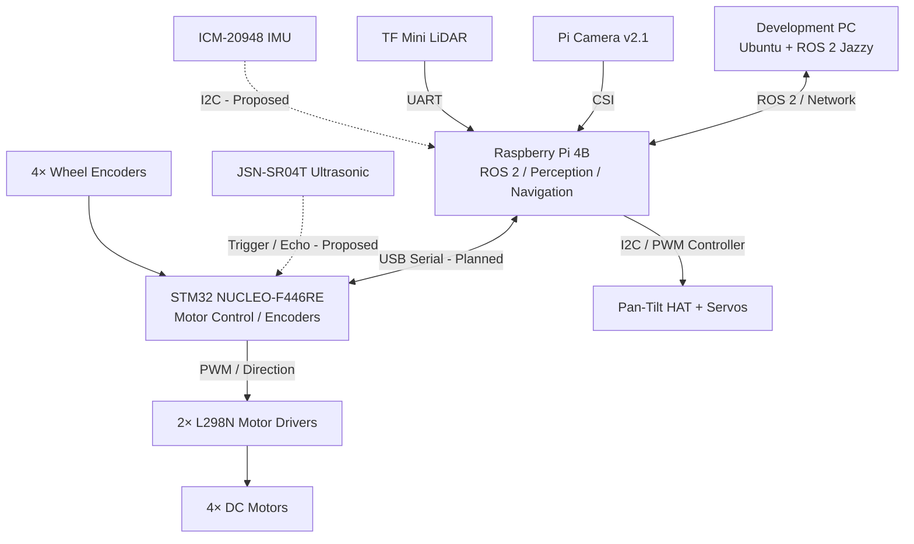
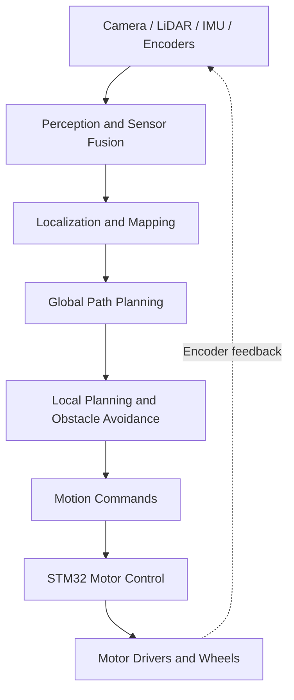

# TISHTAR — System Architecture

## 1. System Overview

**TISHTAR** is a four-wheeled autonomous mobile robot designed and developed from the ground up as a modular platform for **self-driving robotics, computer vision, artificial intelligence, and sensor fusion**.

The primary goal is to develop a robot capable of **autonomously perceiving its environment, making navigation decisions, planning collision-free paths, and driving toward target destinations without continuous human intervention**.

The system follows a distributed computing architecture with three main components:

- **Development PC:** Runs Ubuntu and ROS 2 Jazzy for software development, monitoring, visualization, simulation, and remote robot control.
- **Raspberry Pi 4B:** Serves as the robot's onboard computer, responsible for ROS 2 communication, sensor processing, environment perception, localization, path planning, and high-level autonomous navigation.
- **STM32 NUCLEO-F446RE:** Serves as the low-level controller, responsible for motor control, PWM generation, speed regulation, and wheel encoder feedback.

The robot uses two L298N motor drivers to control four DC motors.

Its sensor suite includes a Raspberry Pi Camera v2.1, TF Mini LiDAR, ICM-20948 IMU, JSN-SR04T ultrasonic sensor, and wheel encoders. These sensors will provide information about the robot's surroundings, motion, and position to support autonomous driving.

### Autonomous Driving Objectives

The long-term goal is to develop and integrate the following capabilities:

1. **Environment Perception:** Detect obstacles, objects, and navigable space using camera, LiDAR, and ultrasonic sensors.
2. **Localization and Mapping:** Estimate the robot's position and build maps of its environment using SLAM and sensor fusion.
3. **Path Planning:** Generate collision-free paths from the robot's current position to a target destination.
4. **Autonomous Motion Control:** Control wheel velocities, acceleration, deceleration, and turning to follow planned trajectories.
5. **Dynamic Obstacle Avoidance:** Detect and respond to moving and stationary obstacles in real time.
6. **Autonomous Decision-Making:** Select appropriate navigation actions based on sensor observations and environmental conditions.
7. **Human-Robot Interaction:** Extend the system toward intelligent service robot applications.

The project will follow an incremental development approach, starting with manual motor control and progressing toward **fully autonomous indoor navigation and self-driving behaviors**.

## 2. Hardware Components

TISHTAR is built around a four-wheel mobile platform with a distributed control architecture. The hardware combines an onboard computer, a microcontroller, motor drivers, sensors, and camera positioning mechanisms.

### 2.1 Computing and Control

| Component | Model | Responsibility |
|---|---|---|
| Onboard computer | Raspberry Pi 4B | ROS 2, perception, SLAM, autonomous navigation |
| Microcontroller | STM32 NUCLEO-F446RE | Low-level motor control, encoder feedback, PWM |
| Development computer | Ubuntu PC | Development, visualization, debugging, simulation |

### 2.2 Locomotion System

| Component | Quantity | Function |
|---|---|---|
| DC motors | 4 | Wheel movement |
| L298N motor drivers | 2 | Motor direction and speed control |
| Wheel encoders | 4 | Wheel rotation and velocity feedback |

The locomotion subsystem is managed by the STM32. High-level motion commands will be generated by ROS 2 and translated into motor control signals.

### 2.3 Sensors

| Sensor | Model | Purpose |
|---|---|---|
| Camera | Raspberry Pi Camera v2.1 (IMX219) | Visual perception and object detection |
| LiDAR | Benewake TF Mini | Distance measurement and obstacle detection |
| IMU | ICM-20948 | Acceleration, angular velocity, and orientation estimation |
| Ultrasonic | JSN-SR04T | Short-range obstacle detection |
| Wheel encoders | 4 encoders | Odometry and wheel velocity estimation |

### 2.4 Camera and Sensor Positioning

| Component | Quantity | Purpose |
|---|---|---|
| Camera pan-tilt HAT | 1 | Camera orientation control |
| PCA9685 PWM controller | 1 (integrated with HAT) | Servo PWM signal generation |
| Camera pan-tilt servos | 2 | Horizontal and vertical camera movement |
| MG90S servos | 2 | Available for experimental mechanisms, including LiDAR scanning |

The camera pan-tilt assembly is planned for installation. It will support active perception and visual object tracking.

A separate experimental LiDAR scanning mechanism is proposed using the TF Mini and a positional servo to collect distance measurements over a horizontal angular range.

### 2.5 Implementation Status

The architecture will evolve as individual subsystems are integrated and tested. The availability of a component does not imply that it has already been installed or integrated with ROS 2.

## 3. Computing Architecture

### 3.1 System Architecture Diagram

### 3.2 Development PC

The development PC runs Ubuntu and ROS 2 Jazzy and serves as the primary environment for developing, testing, and debugging TISHTAR's software.

**Responsibilities:**
- Develop and build ROS 2 packages.
- Monitor robot topics and sensor data.
- Visualize the robot and its surroundings using RViz2.
- Test manual control through keyboard teleoperation.
- Run simulations and evaluate navigation algorithms.
- Perform computationally intensive experiments when necessary.

The development PC communicates with the Raspberry Pi over a network using ROS 2.

### 3.3 Raspberry Pi 4B — High-Level Controller

The Raspberry Pi 4B serves as TISHTAR's onboard computer and is responsible for perception, navigation, and high-level decision-making.

**Responsibilities:**
- Run ROS 2 Jazzy nodes and manage communication between subsystems.
- Acquire and process camera and LiDAR measurements.
- Read IMU measurements for motion estimation.
- Control the camera pan-tilt mechanism.
- Integrate sensor data for environment perception.
- Perform localization and mapping.
- Generate navigation and motion commands.
- Communicate with the STM32 motor controller.

The Raspberry Pi will receive target motion commands and translate them into appropriate low-level commands for the STM32.

### 3.4 STM32 NUCLEO-F446RE — Low-Level Controller

The STM32 is responsible for time-sensitive hardware operations and direct control of the robot's motors.

**Responsibilities:**
- Generate PWM signals for motor speed control.
- Control motor direction through the L298N motor drivers.
- Acquire wheel encoder measurements.
- Estimate wheel rotational speed.
- Implement closed-loop motor speed control.
- Receive motion commands from the Raspberry Pi.
- Report encoder counts and motor status to the Raspberry Pi.
- Implement command timeout and motor-stop safety mechanisms.

Separating low-level motor control from high-level navigation allows the STM32 to maintain predictable control timing independently of Linux scheduling delays.

### 3.5 Control Hierarchy

TISHTAR follows a hierarchical control architecture.

1. **Perception Layer:** Collect and process sensor data to estimate the robot's surroundings and motion.
2. **Localization and Mapping Layer:** Estimate the robot's pose and construct or update environment maps.
3. **Planning Layer:** Generate global paths and local collision-avoidance trajectories.
4. **Motion Control Layer:** Convert desired robot motion into wheel velocity commands.
5. **Actuation Layer:** Apply motor control signals and collect encoder feedback.

The planned communication between the Raspberry Pi and STM32 will use a serial interface. The exact protocol, command format, feedback messages, and communication frequency will be defined during implementation.

### 3.6 Development Status

The computing architecture represents the intended final system. Individual subsystems will be integrated incrementally, beginning with motor control and ROS 2 communication, followed by odometry, perception, SLAM, and autonomous navigation.

## 4. Sensors and Actuators

TISHTAR combines multiple sensors and actuators to support environment perception, motion estimation, obstacle detection, and autonomous navigation.

### 4.1 Raspberry Pi Camera v2.1

- **Sensor:** Sony IMX219
- **Interface:** CSI
- **Controller:** Raspberry Pi 4B
- **Purpose:** Visual perception, object detection, and future visual localization.
- **Planned ROS 2 topic:** `/camera/image_raw`
- **Message type:** `sensor_msgs/msg/Image`

The camera will be mounted on a two-degree-of-freedom pan-tilt mechanism to support active perception and object tracking.

### 4.2 TF Mini LiDAR

- **Type:** Single-point distance sensor
- **Interface:** UART
- **Controller:** Raspberry Pi 4B
- **Purpose:** Distance measurement and obstacle detection.
- **Proposed ROS 2 topic:** `/lidar/range`
- **Message type:** `sensor_msgs/msg/Range`

**Planned extension:** Mount the TF Mini on a servo to collect distance measurements at different angles and generate a partial 2D scan.

- **Proposed scan topic:** `/scan`
- **Message type:** `sensor_msgs/msg/LaserScan`

A servo-based scanner requires calibration and synchronization between servo angle and LiDAR measurements.

### 4.3 ICM-20948 IMU

- **Interface:** I²C (proposed)
- **Controller:** Raspberry Pi 4B
- **Purpose:** Measure acceleration and angular velocity for motion estimation.
- **Proposed ROS 2 topic:** `/imu/data_raw`
- **Message type:** `sensor_msgs/msg/Imu`

The IMU will support robot orientation estimation and future sensor fusion with wheel odometry.

### 4.4 JSN-SR04T Ultrasonic Sensor

- **Interface:** Trigger/Echo, depending on module version
- **Proposed controller:** STM32 NUCLEO-F446RE
- **Purpose:** Close-range obstacle detection and proximity monitoring.
- **Proposed ROS 2 topic:** `/ultrasonic/range`
- **Message type:** `sensor_msgs/msg/Range`

The STM32 may use ultrasonic measurements for local proximity checks and motor-stop safety behavior.

### 4.5 Wheel Encoders

- **Quantity:** 4
- **Controller:** STM32 NUCLEO-F446RE
- **Purpose:** Measure wheel rotation, estimate wheel velocities, and support odometry.
- **Proposed ROS 2 topic:** `/joint_states`
- **Message type:** `sensor_msgs/msg/JointState`

Wheel encoder feedback will be used with the robot's kinematic model to estimate motion. The initial drive model and encoder calibration will be defined during motor-control integration.

### 4.6 Camera Pan-Tilt Mechanism

- **Actuators:** Two servos
- **Controller:** PCA9685 PWM controller connected to Raspberry Pi
- **Purpose:** Independently control horizontal and vertical camera orientation.
- **Status:** Planned installation.

The mechanism will enable camera positioning, active visual search, and object tracking.

### 4.7 DC Motors and Motor Drivers

- **Motors:** 4 DC motors
- **Motor drivers:** 2× L298N
- **Controller:** STM32 NUCLEO-F446RE
- **Purpose:** Drive the wheels, control speed, and change direction.

The STM32 will receive motion commands from the Raspberry Pi and generate PWM and direction signals for the motor drivers.

Closed-loop wheel velocity control will be implemented using encoder feedback.
## 5. Communication Interfaces

## 6. ROS 2 Software Architecture

## 7. Power Distribution and Safety

## 8. Future Improvements

